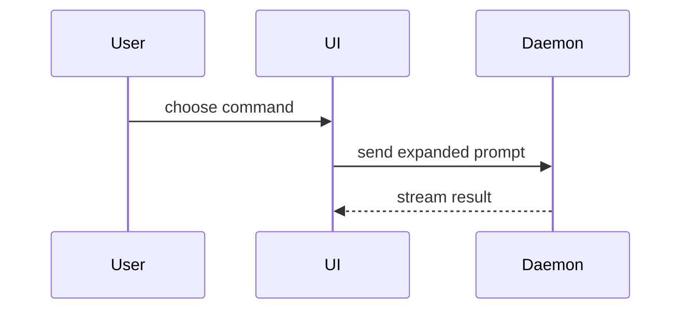

Help the user understand the current topic visually. Skip the preamble and keep prose brief outside the visual itself. Match the depth to the user's choice.

## Choose the depth

- If the user asks for a summarized or detailed view, use that level directly.
- If the level is unspecified and the visual would require a substantial artifact or several sections, ask once in the user’s language. In Portuguese: “Você prefere uma versão resumida, para entender rapidamente, ou detalhada, para discutir decisões e evidências?” Continue gathering source material while waiting. If the user declines to choose, use the summarized level.
- For a simple one-step visual, show the summarized version immediately and mention that a detailed version is available. Do not interrupt a quick explanation with a question.

**Resumida:** Pick the smallest diagram, sketch, comparison, or focused HTML view that makes the main point clear. Include only the context needed to read it.

**Detalhada:** Build a presentation or other navigable artifact when the subject has multiple decisions, flows, or stakeholders. Use enough sections to cover the actual discussion, without a fixed slide count. For an architecture discussion, distinguish the sponsor's stated direction, decisions made in discussion, verified current behavior, proposed architecture, gaps, migration or rollout, user journeys, risks, open questions, and an execution plan when relevant. Reuse that *separation of evidence and decisions*, without imposing a fixed slide count. Give each visual a clear purpose, cite the inspected source or mark an inference, and make the artifact usable on desktop and mobile. For HTML presentations, provide navigation and a printable layout when useful.

At either depth, never present a proposal as implemented behavior or attribute later design decisions to a stakeholder who only supplied the initial direction. Validate generated files, links, and interactive controls as practical; state when visual rendering could not be checked.

- Show logic or an algorithm as pseudocode:

```text
on(save)
  if content is unchanged
    return cached result
  write new content
  return fresh result
```

- Show runtime control flow as a call tree:

```text
submitForm
  createSession
    persistPrompt
    launchAgent
  navigateToSession
```

- Show UI structure as a component tree, including state and module boundaries that matter:

```tsx
<SessionPage> (apps/example/src/routes/session.tsx)
  useSessionEvents()
  <SessionToolbar>
    <RunSkillButton> (packages/ui)
```

- Show file responsibility or a broad refactor as a shallow file tree:

```text
src/
├── commands/       # parses user actions
├── sessions/       # owns session state
└── transport/      # sends API requests
```

- Show component interaction, control flow, or data flow with Mermaid:



- Use `diff` when the point is what changes and the surrounding shape already exists. Match the diff shape to the topic.

For a component change:

```diff
 <SessionPage>
   useSessionEvents()
   <SessionToolbar>
+    <RunSkillButton />
   <SessionTimeline>
+    <SkillResultCard />
```

For a file-layout change:

```diff
 src/
 ├── commands/
+│   └── show-me.ts       # expands the slash command
 ├── sessions/
-└── transport.ts
+└── transport/
+    ├── client.ts
+    └── stream.ts
```

For a call-tree or call-stack change:

```diff
 submitForm
   createSession
     persistPrompt
+    expandSkillMention
     launchAgent
-  navigateToSession
+  navigateToSession
+    subscribeToEvents
```

For a state or control-flow change:

```diff
 on(save)
-  write content
+  if content is unchanged
+    return cached result
+  write new content
+  invalidate cache
```

- Show the whole block when most of it is new, when omitted context would hide ownership or order, or when the user needs a copyable target shape:

```ts
function expandSkill(command: string): string {
  const skillName = command.slice(1)
  return `use the ${skillName} skill`
}
```

- For a visual UI, layout, state comparison, or concept too dense for Mermaid, write one focused HTML file: a diagram, infographic, or slide deck at the chosen depth. Match the product's colors, type, spacing, and components; use real labels and data; support desktop and mobile. Open it with an available file or browser tool, and link the saved file in the answer. If opening fails, report that clearly.

- Place each visual next to the short text it supports. Keep only the calls, files, props, states, and boundaries needed to answer the user's current question.

You may use one of these, you may use several, it is unlikely you will use all of them. Use your judgement and don't overwhelm the user.
